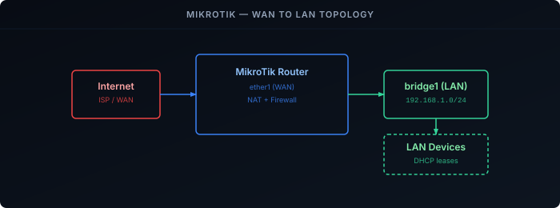

MikroTik routers are a popular choice for homelabs thanks to their flexibility and affordability. This guide walks through a clean, from-scratch configuration covering LAN, WAN, NAT, and firewall rules.



## Prerequisites

- A MikroTik router running RouterOS v7 — check with `/system resource print`
- A way to connect to it — serial cable or Ethernet, covered below

## Connect to the router

You'll need a terminal connection to paste the commands below. Two options:

### Serial cable

1. Connect the serial cable between the router and your computer.
2. Open a terminal app: PuTTY (Windows), `screen` (Linux), or Serial (macOS).
3. Use these settings: **Baud Rate** 115200 · **Data Bits** 8 · **Stop Bits** 1 · **Parity** None · **Flow Control** None.
4. Log in with username `admin` and no password (default).

### SSH

1. Connect your computer to a LAN port on the router via Ethernet.
2. Set your computer to obtain an IP address via DHCP.
3. SSH to the router's default IP (`192.168.88.1`), username `admin`, no password.

## Reset to a blank state

MikroTik routers ship with a default configuration that includes firewall rules, a DHCP server, and NAT. To avoid conflicts, reset to a blank state before continuing:

```bash {filename="Reset Configuration"}
/system reset-configuration no-defaults=yes
```

The router will reboot with **no IP address and no DHCP server**, so SSH won't work until the LAN section below is applied. Reconnect at layer 2 instead:

- **Serial cable** — same settings as above.
- **Winbox by MAC address** — plug into any port, open [Winbox][winbox], and pick the router from the **Neighbors** tab by its MAC address. Winbox has a terminal window for pasting the commands below.

Log in again with `admin` and no password. Once the LAN bridge has `192.168.1.1`, you can switch to SSH by giving your computer a static IP such as `192.168.1.2/24` (or via DHCP once the DHCP section is applied).

To find your port names before building the bridge, run `/interface ethernet print`.

> Replace the placeholder variables shown in `[BRACKETS]` with values that match your environment.

## LAN

### Bridge interface

Create a bridge to combine the LAN ports into a single network. Adjust the port list to match your router model.

```bash {filename="Bridge Interface Setup"}
/interface bridge
add name=bridge1 protocol-mode=none
/interface bridge port
add bridge=bridge1 interface=ether2
add bridge=bridge1 interface=ether3
add bridge=bridge1 interface=ether4
add bridge=bridge1 interface=ether5
add bridge=bridge1 interface=ether6
add bridge=bridge1 interface=ether7
add bridge=bridge1 interface=ether8
add bridge=bridge1 interface=ether9
add bridge=bridge1 interface=ether10
add bridge=bridge1 interface=ether11
add bridge=bridge1 interface=ether12
add bridge=bridge1 interface=ether13
add bridge=bridge1 interface=ether14
add bridge=bridge1 interface=ether15
add bridge=bridge1 interface=ether16
/interface bridge set bridge1 dhcp-snooping=yes
/interface list
add name=LAN
/interface list member
add interface=bridge1 list=LAN
/ip address
add address=192.168.1.1/24 interface=bridge1 network=192.168.1.0
```

### DHCP

Set up a DHCP server to automatically assign IP addresses to connected devices.

```bash {filename="DHCP Server Setup"}
/ip pool
add name=dhcp_pool0 ranges=192.168.1.100-192.168.1.254
/ip dhcp-server network
add address=192.168.1.0/24 dns-server=192.168.1.1 gateway=192.168.1.1 netmask=24
/ip dhcp-server
add address-pool=dhcp_pool0 interface=bridge1 lease-time=1d name=dhcp1
```

### DNS

Allow devices on your network to use the router as a DNS resolver.

```bash {filename="Allow Remote DNS"}
/ip dns
set allow-remote-requests=yes
```

If your WAN connection uses a **static IP**, no upstream DNS is provided automatically. Set one manually:
```bash {filename="Set DNS Servers"}
/ip dns set servers=1.1.1.1,8.8.8.8
```

## WAN

`ether1` is used as the WAN port in this setup. Pick the block that matches your ISP connection type and run it, then run the common step at the bottom.



```bash
/interface vlan add interface=ether1 name=internet vlan-id=[VLAN_ID]
/ip dhcp-client add interface=internet disabled=no use-peer-ntp=no add-default-route=yes
```


```bash
/interface ethernet set ether1 name=internet
/ip dhcp-client add interface=internet add-default-route=yes disabled=no use-peer-ntp=no
```


```bash
/interface vlan add interface=ether1 name=vlan_int vlan-id=[VLAN_ID]
/interface pppoe-client add add-default-route=yes disabled=no interface=vlan_int name=internet use-peer-dns=yes user=[USERNAME] password=[PASSWORD]
```


```bash
/interface pppoe-client add add-default-route=yes disabled=no interface=ether1 name=internet use-peer-dns=yes user=[USERNAME] password=[PASSWORD]
```


```bash
/interface ethernet set ether1 name=internet
/ip address add address=[IP_ADDRESS] interface=internet
/ip route add gateway=[GATEWAY]
/ip dns set servers=[DNS_SERVER]
```



After running the block for your connection type, add the WAN interface to the interface list:

```bash {filename="Add WAN Interface List"}
/interface list add name=WAN
/interface list member add interface=internet list=WAN
```

## NAT

Masquerade outgoing traffic so devices on your LAN can reach the internet using the router's public IP.

```bash {filename="NAT Configuration"}
/ip firewall nat
add action=masquerade chain=srcnat comment="Enable NAT on WAN interface" out-interface-list=WAN
```

## Firewall

Rules are processed top-down. This configuration allows established connections and LAN-initiated traffic, and drops everything else.

> [!WARNING]
> A wrong firewall rule can cut off your own session. Before pasting, press **Ctrl+X** in the terminal to enter **Safe Mode** (the prompt shows `<SAFE>`). If the connection drops while Safe Mode is on, RouterOS automatically reverts every change made since you entered it. Press **Ctrl+X** again to leave Safe Mode and keep the changes.

```bash {filename="Firewall Rules"}
/ip firewall filter
add action=accept chain=forward comment="Allow established,related" connection-state=established,related
add action=drop chain=forward comment="Drop FIN+SYN" connection-state=new protocol=tcp tcp-flags=fin,syn
add action=drop chain=forward comment="Drop SYN+RST" connection-state=new protocol=tcp tcp-flags=syn,rst
add action=drop chain=forward comment="drop invalid traffic" connection-state=invalid
add action=accept chain=forward comment="internet traffic" in-interface-list=LAN out-interface-list=WAN
add action=accept chain=forward comment="port forwarding" connection-nat-state=dstnat
add action=drop chain=forward comment="drop all else"
add action=accept chain=input comment="Allow established,related" connection-state=established,related
add action=drop chain=input comment="Drop invalid" connection-state=invalid
add action=drop chain=input comment="Drop SYN+RST" connection-state=new protocol=tcp tcp-flags=syn,rst
add action=drop chain=input comment="Drop FIN+SYN" connection-state=new protocol=tcp tcp-flags=fin,syn
add action=accept chain=input comment="Allow WireGuard" dst-port=51820 in-interface-list=WAN protocol=udp
add action=accept chain=input comment="Allow traffic from LAN interface list to the router" in-interface-list=LAN
add action=drop chain=input comment="Drop all else"
add action=accept chain=output comment="Allow established,related" connection-state=established,related
add action=drop chain=output comment="Drop invalid" connection-state=invalid
add action=accept chain=output comment="Router DHCP client to WAN" dst-port=67 out-interface-list=WAN protocol=udp
add action=accept chain=output comment="Router DNS to WAN" dst-port=53 out-interface-list=WAN protocol=udp
add action=accept chain=output comment="Router DNS to WAN (TCP)" dst-port=53 out-interface-list=WAN protocol=tcp
add action=accept chain=output comment="Router NTP to WAN" dst-port=123 out-interface-list=WAN protocol=udp
add action=accept chain=output comment="Router HTTP/HTTPS to WAN (updates)" dst-port=80,443 out-interface-list=WAN protocol=tcp
add action=accept chain=output comment="Router Allow Cloud DDNS" dst-port=15252 out-interface-list=WAN protocol=udp
add action=accept chain=output comment="Router ICMP to WAN" out-interface-list=WAN protocol=icmp
add action=accept chain=output comment="Router to LAN" out-interface-list=LAN
add action=drop chain=output comment="Drop all else"
/ip firewall service-port
set ftp disabled=yes
set tftp disabled=yes
set h323 disabled=yes
set sip disabled=yes
```

## System

### User account

Create a new admin user, then disable the default `admin` account to prevent unauthorized access.

```bash {filename="Create User Account"}
/user add name=[USERNAME] password=[PASSWORD] group=full
/user disable admin
```

### Hostname

```bash {filename="Set Hostname"}
/system identity
set name=[HOSTNAME]
```

### NTP

Enable NTP to keep the router's clock in sync and set your local timezone.

```bash {filename="NTP Configuration"}
/system ntp client
set enabled=yes
/system ntp client servers
add address=time.cloudflare.com
/system clock
set time-zone-name=[TIMEZONE]
```

### Restrict management services

MikroTik enables several management interfaces by default (API, Winbox, web UI, Telnet) that are accessible from all interfaces. Disable unused ones and restrict the rest to your LAN subnet.

```bash {filename="Restrict Management Services"}
/ip service
set api disabled=yes
set api-ssl disabled=yes
set telnet disabled=yes
set www disabled=yes
set www-ssl disabled=yes
set ssh address=192.168.1.0/24
set winbox address=192.168.1.0/24
```

## Verify

Check each layer in order, from the router out:

```bash {filename="Verification"}
/ip dhcp-client print        # status should be "bound" (DHCP WAN)
/interface pppoe-client print # or: status "connected" (PPPoE WAN)
/ip route print where dst-address=0.0.0.0/0   # a default route must exist
/ping 1.1.1.1 count=3
/ping cloudflare.com count=3  # proves the router's own DNS works
/ip dhcp-server lease print   # LAN clients that received an address
```

From a LAN client, browse to any website to confirm NAT and the forward chain are working.

## Troubleshooting

**Locked out after applying the firewall.** Connect over serial or Winbox by MAC address — the IP firewall doesn't filter layer-2 management connections. Then check the input chain with `/ip firewall filter print chain=input`: the "Allow traffic from LAN" rule must come before "Drop all else", and `bridge1` must be in the `LAN` interface list (`/interface list member print`).

**The router has internet but LAN clients don't.** Check the NAT rule's packet counters with `/ip firewall nat print stats`. If they stay at zero, the WAN interface isn't in the `WAN` list — the masquerade rule matches on `out-interface-list=WAN`. For PPPoE, the list member must be the PPPoE interface (`internet`), not `ether1`.

**Clients get an address but names don't resolve.** Confirm `allow-remote-requests=yes`, and that `/ip dns print` shows upstream servers (dynamic ones come from the WAN). Then test from a client with `nslookup example.com 192.168.1.1`.

**No DHCP lease from the ISP.** Many ISPs require a VLAN tag on the WAN — check whether yours needs the "with VLAN" variant, and confirm the VLAN ID. `/log print where topics~"dhcp"` shows whether the router is sending discovers and getting replies.

---

Your MikroTik router is now configured with a secure baseline. From here you can expand with VLANs, more granular firewall rules, or additional services like a [WireGuard VPN]().

[winbox]: https://mikrotik.com/download
