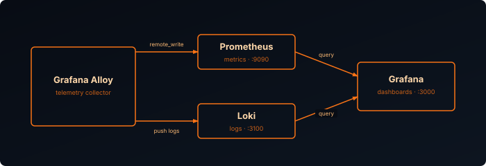

Before you can collect metrics or centralize logs, you need somewhere to store and visualize them — and an agent to collect the data. This post sets up all four components of a Grafana observability stack:

- **Prometheus** — metrics storage
- **Loki** — log storage
- **Grafana** — visualization
- **Grafana Alloy** — telemetry collection agent



## Prometheus

Prometheus is a time-series database that stores metrics. We'll enable the remote write receiver so Alloy can push metrics directly to it.

Create a directory and Docker Compose file:

```bash
mkdir prometheus
nano prometheus/docker-compose.yml
```

```yaml {filename="docker-compose.yml"}
services:
  prometheus:
    image: prom/prometheus:v3.15.0
    container_name: prometheus
    environment:
      - TZ=Europe/Amsterdam
    volumes:
      - ./prometheus.yml:/etc/prometheus/prometheus.yml:ro
      - prometheus:/prometheus
    command:
      - '--config.file=/etc/prometheus/prometheus.yml'
      - '--storage.tsdb.path=/prometheus'
      - '--storage.tsdb.retention.time=90d'
      - '--storage.tsdb.retention.size=100GB'
      - '--web.enable-lifecycle'
      - '--web.enable-remote-write-receiver'
    restart: unless-stopped
    networks:
      - backend

networks:
  backend:
    name: backend

volumes:
  prometheus:
    name: prometheus
```

Create the Prometheus config file:

```bash
nano prometheus/prometheus.yml
```

```yaml {filename="prometheus.yml"}
global:
  scrape_interval: 15s
  evaluation_interval: 15s

scrape_configs: []
```

`scrape_configs` is empty because Alloy pushes metrics via remote write. Adjust `retention.time` and `retention.size` to match your available disk space — whichever limit is hit first triggers cleanup.

The Prometheus stack is the one that creates the `backend` network. Every other component in this post joins it as an `external` network, so start Prometheus first:

```bash
docker compose -f prometheus/docker-compose.yml up -d
```

Prometheus doesn't publish a port to the host — only containers on `backend` can reach it. Verify it's ready from a throwaway container on that network:

```bash
docker run --rm --network backend curlimages/curl:8.23.0 -s http://prometheus:9090/-/ready
# Prometheus Server is Ready.
```

## Loki

Loki stores logs indexed by labels rather than full-text, making it storage-efficient and fast for label-based queries.

Create a directory and Docker Compose file:

```bash
mkdir loki
nano loki/docker-compose.yml
```

```yaml {filename="docker-compose.yml"}
services:
  loki:
    image: grafana/loki:3.7.8
    container_name: loki
    restart: unless-stopped
    environment:
      - TZ=Europe/Amsterdam
    volumes:
      - ./loki-config.yaml:/etc/loki/loki-config.yaml:ro
      - loki-data:/loki
    command: -config.file=/etc/loki/loki-config.yaml
    networks:
      - backend

networks:
  backend:
    external: true

volumes:
  loki-data:
    name: loki-data
```

Create the Loki config file:

```bash
nano loki/loki-config.yaml
```

```yaml {filename="loki-config.yaml"}
auth_enabled: false

server:
  http_listen_address: 0.0.0.0
  http_listen_port: 3100
  grpc_listen_port: 9095
  log_level: info

common:
  instance_addr: 127.0.0.1
  path_prefix: /loki
  storage:
    filesystem:
      chunks_directory: /loki/chunks
      rules_directory: /loki/rules
  replication_factor: 1
  ring:
    kvstore:
      store: memberlist

schema_config:
  configs:
    - from: 2020-10-24
      store: tsdb
      object_store: filesystem
      schema: v13
      index:
        prefix: index_
        period: 24h

limits_config:
  query_timeout: 600s
  retention_period: "365d"
  ingestion_rate_mb: 4
  ingestion_burst_size_mb: 6
  max_streams_per_user: 10000
  max_line_size: 256000
  reject_old_samples: true
  reject_old_samples_max_age: 168h
  creation_grace_period: 15m
  discover_log_levels: false
```

Adjust `retention_period` based on your available disk space.

Start Loki:

```bash
docker compose -f loki/docker-compose.yml up -d
```

Verify it's ready:

```bash
docker run --rm --network backend curlimages/curl:8.23.0 -s http://loki:3100/ready
# ready
```

Loki can report `Ingester not ready: waiting for 15s after being ready` for the first few seconds after startup — wait and run it again.

## Grafana

Grafana is the visualization layer — it connects to Prometheus and Loki and lets you build dashboards and explore data.

Create a directory and Docker Compose file:

```bash
mkdir grafana
nano grafana/docker-compose.yml
```

```yaml {filename="docker-compose.yml"}
services:
  grafana:
    image: grafana/grafana:13.2.4
    container_name: grafana
    environment:
      - TZ=Europe/Amsterdam
      - GF_SECURITY_ADMIN_PASSWORD=admin
    volumes:
      - grafana-data:/var/lib/grafana
    restart: unless-stopped
    ports:
      - 3000:3000
    networks:
      - backend

networks:
  backend:
    external: true

volumes:
  grafana-data:
    name: grafana-data
```

Change `GF_SECURITY_ADMIN_PASSWORD` to a secure password before starting.

Start Grafana:

```bash
docker compose -f grafana/docker-compose.yml up -d
```

Open `http://<HOST_IP>:3000` and log in with username `admin` and your password.

### Add Datasources

Connect Grafana to Prometheus and Loki:

**Prometheus:**
1. Click **Connections** → search for **Prometheus** → **Add new Datasource**
2. Set name `prometheus`, URL `http://prometheus:9090`
3. Click **Save & Test**

**Loki:**
1. Click **Connections** → search for **Loki** → **Add new Datasource**
2. Set name `loki`, URL `http://loki:3100`
3. Click **Save & Test**

## Grafana Alloy

Alloy is the telemetry collection agent that replaces Promtail and Grafana Agent. It collects metrics, logs, and traces and forwards them to Prometheus and Loki using a modular config — each collector lives in its own `.alloy` file, and every file in the config directory is loaded automatically.

### Install Alloy

Create a directory for Alloy and its config files:

```bash
mkdir -p alloy/config
nano alloy/docker-compose.yml
```

```yaml {filename="docker-compose.yml"}
services:
  alloy:
    image: grafana/alloy:v1.20.1
    container_name: alloy
    hostname: ${HOSTNAME}
    restart: unless-stopped
    environment:
      - TZ=Europe/Amsterdam
    ports:
      - "12345:12345"
    volumes:
      - ./config/:/etc/alloy/config/:ro
      - alloy-data:/var/lib/alloy/data
    command:
      - run
      - --server.http.listen-addr=0.0.0.0:12345
      - --storage.path=/var/lib/alloy/data
      - /etc/alloy/config/
    networks:
      - backend

networks:
  backend:
    external: true

volumes:
  alloy-data:
    name: alloy-data
```

Alloy loads every `.alloy` file in the `config/` directory automatically — adding a new collector is as simple as dropping in a new file. Port `12345` is the Alloy web UI for debugging component status.

`hostname: ${HOSTNAME}` names the container after the host so logs and metrics can be told apart per machine. Most shells set `HOSTNAME` without exporting it, so Compose can't see it — set it explicitly in `alloy/.env`:

```bash {filename="alloy/.env"}
HOSTNAME=<this-host's-name>
```

### Endpoints

Create `endpoint.alloy` to centralize write destinations. All collector configs reference these by name:

```bash
nano alloy/config/endpoint.alloy
```

```hcl {filename="endpoint.alloy"}
loki.write "default" {
  endpoint {
    url = "http://loki:3100/loki/api/v1/push"
  }
}

prometheus.remote_write "default" {
  endpoint {
    url = "http://prometheus:9090/api/v1/write"
  }
}
```

### Self-Monitoring

Create `self.alloy` so Alloy reports its own health metrics to Prometheus:

```hcl {filename="self.alloy"}
prometheus.exporter.self "alloy_metrics" {}

prometheus.scrape "alloy_metrics" {
  targets         = prometheus.exporter.self.alloy_metrics.targets
  scrape_interval = "60s"
  forward_to      = [prometheus.remote_write.default.receiver]
}
```

No extra permission steps needed here — the bind-mounted `config/` directory is already owned correctly on the host. Each collector you add later (Unifi Syslog, Traefik Observability) documents whatever mount it specifically needs.

### Start Alloy

```bash
docker compose -f alloy/docker-compose.yml up -d
```

### Verify

Confirm Alloy is healthy and listening:

```bash
curl -s http://localhost:12345/-/healthy
```

Open the Alloy web UI at `http://<HOST_IP>:12345` and verify all components show green. The `prometheus.remote_write.default` and `loki.write.default` components should both be running.

As a final end-to-end check, open Grafana's **Explore** view, pick the Prometheus datasource, and run `alloy_build_info`. A result means the whole metrics path works: Alloy scraped itself, remote-wrote to Prometheus, and Grafana queried it back.

## Troubleshooting

**`network backend declared as external, but could not be found`.** The Prometheus stack creates the network, so it has to be started first. Run `docker compose -f prometheus/docker-compose.yml up -d`, then start the others.

**Save & Test on a datasource fails with `no such host` or `connection refused`.** Grafana resolves `prometheus` and `loki` by container name, which only works on a shared network. Check that all four containers are listed in `docker network inspect backend`.

**Alloy's `prometheus.remote_write` component reports errors.** A `404` from `/api/v1/write` means Prometheus is running without `--web.enable-remote-write-receiver` — check the flag in the `command` list and recreate the container. Connection errors mean Alloy isn't on the `backend` network.

**An Alloy config change doesn't take effect.** Alloy refuses to load a config with a syntax error and keeps running the previous one. Check `docker logs alloy` for the parse error, which includes the file name and line.

**Loki logs `permission denied` on `/loki`.** The Loki image runs as a non-root user (UID `10001`). A named volume, as used here, gets the right ownership automatically; if you switched to a bind mount, run `sudo chown -R 10001:10001` on the host directory.

With Prometheus, Loki, Grafana, and Alloy all running, the base stack is in place. What you collect through it depends on what you're monitoring — this series continues with:

- [Unifi Syslog with Alloy and Loki][unifi-logs] — forward Unifi device logs into Loki
- [Traefik Reverse Proxy: Observability][traefik-observability] — scrape Traefik's Prometheus metrics and collect its access logs via Alloy

[unifi-logs]: 
[traefik-observability]: 
