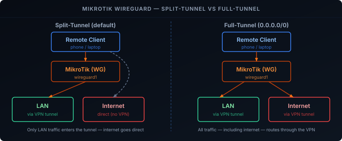

WireGuard is a modern, high-performance VPN protocol that is simple to configure and provides excellent security. MikroTik routers running RouterOS v7 and above have built-in WireGuard support, making it easy to set up a VPN server for secure remote access to your homelab network.

## Prerequisites

Before starting, ensure you have:

- **MikroTik router** running RouterOS v7 or later with WireGuard package installed. See the [Setting Up a MikroTik Router]() guide for initial setup.
- **SSH or terminal access** to your MikroTik router
- **Client devices** where you'll install WireGuard (Linux, macOS, Windows, iOS, or Android)
- **Public IP address** or dynamic DNS hostname for your router (for remote access)
- **Understanding of your network topology** (WAN interface name, LAN subnet, etc.)

> Replace the placeholder variables with values that match your environment.

## WireGuard Interface

Create a WireGuard interface on the router. This will automatically generate a private and public key pair for the server.

```bash {filename="WireGuard Interface"}
/interface wireguard
add name=wireguard1 listen-port=51820 mtu=1420 comment="Remote VPN"
```

Assign an IP address to the WireGuard interface. This will be the gateway address for the VPN subnet.

```bash {filename="IP Address Configuration"}
/ip address
add address=192.168.100.1/24 interface=wireguard1 comment="WG subnet"
```

## Firewall Rules

Add firewall rules to allow WireGuard traffic and permit communication between VPN clients and your LAN.

RouterOS appends new rules to the **end** of the chain, after any existing drop rule, where they would never match. `place-before` inserts them above it instead. The commands below assume the rule comments from the [initial router setup](); adjust the `comment=` match if your drop rules are named differently.

```bash {filename="Firewall Configuration"}
/ip firewall filter
add chain=input action=accept protocol=udp dst-port=51820 in-interface-list=WAN comment="Allow WireGuard" place-before=[find chain=input comment="Drop all else"]
add chain=forward action=accept in-interface=wireguard1 out-interface=bridge1 comment="WG to LAN" place-before=[find chain=forward comment="drop all else"]
add chain=forward action=accept in-interface=bridge1 out-interface=wireguard1 comment="LAN to WG" place-before=[find chain=forward comment="drop all else"]
```

If you followed the initial router setup guide, the first rule already exists — skip it and add only the two forward rules. Check the result with `/ip firewall filter print chain=forward`: both WG rules must be listed above "drop all else".

## Peers

On your MikroTik router, you must add a peer for **each client** that should connect to the VPN.

You will need the **client’s public key** from its WireGuard configuration.

```bash {filename="Add Peer"}
/interface wireguard peers
add interface=wireguard1 public-key="[CLIENT-PUBLIC-KEY]" allowed-address=192.168.100.2/32 name=RemoteUser1
```

Each peer should have a unique IP address within the WireGuard subnet (`192.168.100.0/24`). The `allowed-address` value must match the Address configured on the client.

## Client Configuration

On the client device, configure WireGuard as follows:

```ini {filename="Client"}
[Interface]
PrivateKey = [CLIENT-PRIVATE-KEY]
ListenPort = 51821
Address = 192.168.100.2/32

[Peer]
PublicKey = [ROUTER-PUBLIC-KEY]
AllowedIPs = 192.168.100.0/24, 192.168.1.0/24
Endpoint = [YOUR-PUBLIC-IP]:51820
```

- **Endpoint**: Your router’s public IP address or hostname and the WireGuard listen port. (e.g., `your-public-ip:51820`)
- **AllowedIPs**: Defines which networks are reachable through the VPN tunnel.
- **PublicKey**: Retrieve it from the router with `/interface wireguard print`. This must be the **router's public key**, not the client's.

## Internet over the VPN
The configuration above is a **split-tunnel** setup. Only traffic destined for the specified networks in `AllowedIPs` is sent through the VPN.

If you want **all internet traffic** to go through the VPN (full-tunnel setup), additional configuration is required.



### Modify the Client Configuration

On the client, change `AllowedIPs` to:

```ini
[Peer]
AllowedIPs = 0.0.0.0/0
```

#### DNS Considerations
When using full-tunnel mode, DNS should also go through the VPN. Use your MikroTik's address or any DNS server reachable through the VPN:

```ini
[Interface]
DNS = 192.168.100.1
```

This ensures DNS queries are also routed through the VPN tunnel. Alternatively, use a public DNS server like `1.1.1.1` or `8.8.8.8`.

### Firewall Rules for Full-Tunnel

To enable internet traffic through the VPN, add these rules:

```bash {filename="Full-Tunnel Firewall Rules"}
/ip firewall filter
add action=accept chain=forward comment="WG to Internet" in-interface=wireguard1 out-interface-list=WAN place-before=[find chain=forward comment="drop all else"]
add action=accept chain=input comment="Allow traffic from WG to router" in-interface=wireguard1 place-before=[find chain=input comment="Drop all else"]
```

The existing masquerade rule (`out-interface-list=WAN`) already covers traffic from the WireGuard subnet, so no extra NAT rule is needed.

## Verify

Activate the tunnel on the client, then check the peer on the router:

```bash {filename="Verify"}
/interface wireguard peers print detail
```

A working peer shows a recent `last-handshake` and non-zero `rx`/`tx` counters. From the client, `ping 192.168.100.1` tests the tunnel itself, and `ping 192.168.1.1` tests routing into the LAN.

## Troubleshooting

**No handshake at all (`last-handshake` stays empty).** The UDP packets aren't reaching the router, or the keys don't match. Check that:

- The client's `Endpoint` is your current public IP. If the router sits behind an ISP modem, forward UDP 51820 on the modem. If your ISP uses CGNAT (the WAN address is in `100.64.0.0/10`), inbound connections can't reach you at all.
- The router peer has the **client's** public key, and the client `[Peer]` has the **router's** public key — swapping them is the most common mistake.

**Handshake works but the LAN is unreachable.** The forward rules are probably below the drop rule — check the order with `/ip firewall filter print chain=forward`. Also confirm the client's `Address` matches the peer's `allowed-address` exactly: the router drops packets from any other source address.

**The tunnel drops after a few minutes of idle time.** A NAT device between the client and the router has expired the UDP mapping. Add a keepalive to the client's `[Peer]` section:

```ini
PersistentKeepalive = 25
```

**Full-tunnel connects, but websites don't load.** DNS is usually the culprit. The client's `DNS = 192.168.100.1` needs the "Allow traffic from WG to router" input rule and `allow-remote-requests=yes` on the router. Test with `nslookup example.com 192.168.100.1` from the client.

## Conclusion

With WireGuard configured on your MikroTik, you now have a fast, modern, and secure VPN tunnel into your homelab from anywhere. The setup is straightforward and significantly simpler than older VPN protocols like OpenVPN or IPSec, while maintaining excellent performance and security.
