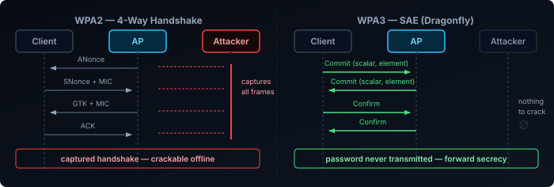
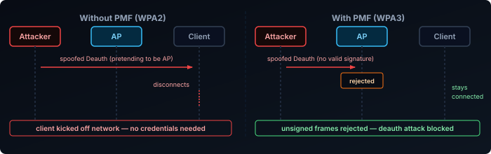

WPA3 has been around since 2018, but most people enabled it because their router's UI said to — without knowing what actually changed. Some of the improvements are subtle, some are significant, and a few things WPA3 is assumed to fix it doesn't. This post covers the main components — SAE (the new handshake), PMF (protected management frames), OWE (open network encryption), SAE-PK (public-key AP authentication), and the Enterprise 192-bit mode — plus where WPA3 is now mandatory (6 GHz), what WiFi 7 adds on top of it and why that's where device compatibility breaks, how MAC randomisation fits the same privacy story, and where WPA3 still falls short.

## What Was Wrong with WPA2

WPA2-Personal uses a Pre-Shared Key (PSK): a password known to both the AP and the client. The 4-way handshake that authenticates a client can be captured passively — you don't need to be on the network or even interact with it. Once you have the handshake, you can run a dictionary or brute-force attack against it offline, at GPU speed, with no rate limiting.

Two attacks made this concrete:

- **KRACK (2017)** — Key Reinstallation Attack. A design flaw in the WPA2 4-way handshake itself: replaying a handshake message forces the client to reinstall an already-in-use key, resetting nonces and breaking encryption for active sessions. Correct, spec-compliant implementations were still vulnerable.
- **PMKID attack (2018)** — An attacker can request a single PMKID frame from an AP without a client being present, then crack the PSK offline. No handshake capture required.

KRACK was a flaw in the handshake's state machine, and was patched in client and AP implementations. The PMKID attack — and plain handshake capture — point at a deeper problem that patches can't fix: everything in the handshake is derived directly from a static PSK, so any captured material can be used to test password guesses offline, indefinitely, after the fact.

## SAE: Simultaneous Authentication of Equals

SAE replaces how the shared key is derived from the password. In WPA2-Personal the PSK *is* the pairwise master key (PMK); in WPA3 the PMK comes out of a Password Authenticated Key Exchange (PAKE) called the Dragonfly handshake (defined in RFC 7664). The familiar 4-way handshake still runs afterwards — but it now starts from a fresh, per-session PMK that has no offline relationship to the password. The key properties:

- **Nothing captured can be tested offline.** Both sides prove they know the password without exposing anything derived from it alone. An attacker capturing the exchange — SAE or the 4-way handshake that follows — gets nothing they can run guesses against; each guess requires a live exchange with the AP.
- **Forward secrecy.** A unique session key is derived per connection. Capturing today's traffic and cracking the password later doesn't decrypt it — the session key is gone.
- **Commit-Confirm structure.** Both sides exchange commit frames (deriving a shared secret from the password and random values), then confirm frames (proving both arrived at the same secret). Neither side can complete authentication without knowing the password.

This directly kills the PMKID and handshake-capture attacks. Offline cracking is no longer possible because there's nothing to crack.

SAE does have one known weakness: **Dragonblood (2019)** — a timing and cache side-channel that could leak information about the password under specific conditions. The root cause was the original password derivation method, which had variable execution time that could be measured by an attacker. This was fixed in WPA3 Release 2 (2020) with **Hash-to-Element (H2E)**: a constant-time derivation that removes the timing signal entirely. Most current APs and clients default to H2E, but older firmware may still fall back to the original method.

## SAE-PK: Authenticating the AP on Public Networks

SAE proves both sides know the password. That is exactly the problem on a network where the password is *public* — a café that prints it on the receipt, a conference SSID on a slide, a hotel lobby sign. Anyone who knows the password can stand up an evil twin with the same SSID and password, and SAE completes normally against it. The client has no way to tell the operator's AP from an impostor that read the same sign.

**SAE-PK** (SAE with Public Key, added in WPA3 Release 3) closes this for operators who opt in. The AP holds a private key, and its public key is fingerprinted into the password string itself — the password is no longer free-form but a generated value like `a2bc-de3f-ghij-klmn` that encodes the fingerprint. During the SAE exchange the AP signs its messages with the private key, and the client checks that signature against the fingerprint carried in the password it was given. An attacker who knows the password still cannot produce the signature without the private key, so the evil twin fails verification.

The trade-offs: the password is machine-generated and longer than users would pick, both AP and client must support it, and adoption so far is thin — it targets hotspot operators, not home networks. It narrows the evil-twin gap for shared-password SAE networks; it does nothing for a normal home network where only trusted people have the password anyway.

## PMF: Protected Management Frames

Management frames (probe requests, authentication, association, deauthentication) were never encrypted in WPA2. An attacker could send a spoofed deauthentication frame to any client, forcing it off the network — no credentials needed. This is the basis of deauth attacks used in everything from WiFi jammers to evil twin setups.

WPA3 mandates PMF (802.11w). Management frames are now cryptographically protected:

- **Deauth and disassoc frames** are signed, so a spoofed frame from an attacker is rejected.
- **Unicast management frames** are encrypted between client and AP.
- **Broadcast management frames** use a group key to prevent spoofing.

PMF was optional in WPA2 (and widely ignored). Making it mandatory in WPA3 removes a class of denial-of-service attacks that have existed since the beginning of WiFi.

## OWE: Opportunistic Wireless Encryption

Open networks (coffee shops, hotels, airports) have always been unencrypted. Everyone on the network shares the same encryption key — which is nothing. Any device on the network can read any other device's traffic.

OWE (RFC 8110) addresses this without requiring a password. During association, the client and AP perform a Diffie-Hellman exchange and derive a unique per-client session key. The network is still "open" from a user perspective — no password prompt — but each client's traffic is encrypted with a key only that client and the AP know.

OWE doesn't provide authentication. You still don't know if you're on the legitimate AP or an evil twin. But it eliminates passive sniffing by other clients on the same network, which is the most common threat on open networks.

## FILS: Fast Initial Link Setup

OWE improves open networks; FILS (802.11ai) improves how fast devices reconnect to networks they already know. It isn't part of WPA3 — the Wi-Fi Alliance certifies it separately under Wi-Fi CERTIFIED Optimized Connectivity — but it's a close companion to the SAE and PMF work and often ships alongside it.

On 802.1X/RADIUS enterprise networks, a full EAP exchange on every reconnect adds 300–500 ms before traffic can flow. For a phone moving between APs in a large building, this latency is noticeable on VoIP calls and video streams. FILS shortens this significantly for returning clients:

- The first association is a full EAP exchange. FILS derives and caches a **FILS key** from that session.
- On subsequent associations to any AP in the same [mobility domain](#80211r--fast-bss-transition) — the group of APs that coordinate fast transitions — the client presents the cached FILS key material. Most of the EAP exchange is skipped.
- Authentication completes in 1–2 RTTs rather than a multi-step EAP ladder.

FILS is most relevant in high-density environments — stadiums, hospitals, transit hubs — where many devices reconnect frequently and 802.1X is already in use. It requires support on both the AP and the RADIUS server/supplicant stack. Adoption is narrower than SAE or PMF because it only matters for enterprise networks with 802.1X, not for home WPA3-Personal deployments.

## WPA3-Enterprise

WPA3-Personal (SAE) is for home and small business use. WPA3-Enterprise targets environments that already use 802.1X authentication (RADIUS) and adds a 192-bit security suite:

- **AES-256-GCMP** for data encryption (up from AES-128-CCMP in WPA2-Enterprise)
- **HMAC-SHA-384** for key derivation
- **ECDHE and ECDSA** with 384-bit elliptic curves for key exchange and authentication

This is aimed at high-security environments: government, financial, healthcare. For most corporate networks still using WPA2-Enterprise with proper EAP methods (EAP-TLS), the practical security difference is minimal.

## Transition Mode

Most modern APs support WPA2/WPA3 transition mode — the same SSID accepts both WPA2 and WPA3 clients simultaneously. This is necessary during the years-long period where device support is mixed.

The tradeoff: in transition mode, the network must still support WPA2 to accommodate older clients. An attacker can attempt to downgrade a WPA3-capable client to WPA2 by interfering with the negotiation. This is harder with PMF enabled (since deauth spoofing is blocked), but it reduces the security guarantee compared to a WPA3-only network.

One specific risk worth naming: WPA2 clients on the same SSID are still vulnerable to the PMKID attack. An attacker targeting those clients doesn't need to engage the WPA3 clients at all — the same shared password is exposed through the WPA2 material. Transition mode keeps the full WPA2 attack surface alive alongside WPA3.

A WPA3-only network gives the full benefit. Transition mode is a practical compromise.

## WPA3 Is Mandatory on 6 GHz

Transition mode is a 2.4 and 5 GHz concession. It does not exist on 6 GHz.

The regulatory decisions that opened the 6 GHz band (the FCC in the US, and equivalents elsewhere) require that every 6 GHz connection is protected: WPA3-SAE for password networks, OWE for open ones. WPA2, TKIP, and plain unencrypted open are not permitted on a 6 GHz BSS. A 6 GHz radio is WPA3-only by definition — there is nothing to transition from.

6 GHz is also stricter about *how* SAE runs: only the constant-time **Hash-to-Element (H2E)** derivation is allowed. The original hunting-and-pecking method — the one Dragonblood targeted — is rejected on 6 GHz, while 2.4 and 5 GHz radios still accept it as a fallback for older clients.

The practical effects:

- On a tri-band WPA2/WPA3 transition SSID, the 2.4 and 5 GHz radios accept both, but the 6 GHz radio only admits WPA3 clients that support H2E. Some vendors will not broadcast the 6 GHz radio at all until WPA3 is enabled on the SSID.
- **WiFi 6E and WiFi 7 client certification require WPA3 support.** A device carrying the logo can always do SAE.

## What WiFi 7 Adds to WPA3

WiFi 7 doesn't just require WPA3 — it requires a stronger configuration of it. For a WiFi 7 association (and therefore for [Multi-Link Operation](#what-mlo-requires)), the SSID needs:

- **SAE-EXT-KEY (AKM 24).** An extended variant of SAE. The original SAE (AKM 8) is tied to a fixed hash and key length; SAE-EXT-KEY scales them to the elliptic-curve group in use, which the stronger cipher below needs. It always uses H2E. Its fast-roaming counterpart, FT-SAE-EXT-KEY, is AKM 25.
- **GCMP-256** as the data cipher, instead of the AES-128 CCMP that WPA2, WPA3 and WiFi 6E use. OWE networks have the same requirement.
- **PMF required**, not just "capable".
- **Beacon Protection.** PMF protects management frames sent to and from a client, but beacons are broadcast and were still unauthenticated — so an attacker could forge beacon contents such as channel-switch or power settings. Beacon Protection signs each beacon with a group key, letting associated clients detect forged ones.

The "AKM" numbers are worth knowing because they're what you'll see in packet captures, client connection details and some vendors' settings pages. AKM 2 is WPA2-Personal, AKM 8 is the original WPA3-Personal, and AKM 24 is the WiFi 7 variant.

### Why This Is Where Compatibility Breaks

Many WiFi 6 and 6E devices support WPA3, but only AKM 8 with AES-128. An SSID that offers *only* AKM 24 with GCMP-256 is invisible to them in practice: it's WPA3, they do WPA3, and they still can't join.

APs handle this by advertising both sets on the same SSID — AKM 8 with AES-128 alongside AKM 24 with GCMP-256 — and letting each client pick the strongest combination it supports. WiFi 7 clients choose AKM 24 and get MLO; WiFi 6/6E clients choose AKM 8 and connect on a single link, exactly as they would on a WiFi 6E network. Adding WPA2 transition mode on 2.4 and 5 GHz extends the same SSID to older devices still, at the cost covered in [Transition Mode](#transition-mode).

| Client | 2.4 / 5 GHz | 6 GHz | MLO |
|---|---|---|---|
| WPA2-only | Only via transition mode | No | No |
| WPA3, AKM 8 (most WiFi 6/6E) | Yes | Yes, if it supports H2E | No |
| WPA3, AKM 24 + GCMP-256 (WiFi 7) | Yes | Yes | Yes |

This is also why an SSID can look MLO-capable while clients quietly connect on a single link: if the AP doesn't offer AKM 24 with GCMP-256, a WiFi 7 client falls back to WiFi 6E behaviour without any error.

## What WPA3 Doesn't Fix

| Problem | WPA3 helps? | Why not |
|---------|-------------|---------|
| Weak passwords | No | SAE raises the cost of cracking, but a short password is still guessable |
| Evil twin / rogue AP | Partly | Plain SAE doesn't help — anyone who knows the password can impersonate the AP. SAE-PK fixes it for public networks that adopt it; WPA3-Enterprise with EAP-TLS fixes it with certificates. Plain WPA3-Personal has no AP identity check. |
| Client implementation bugs | No | Dragonblood showed correct-spec implementations can still have exploitable side-channels |
| Traffic analysis | No | Metadata — timing, packet sizes, destinations — is still visible regardless of encryption |
| Insider threats | No | Anyone with the password can still observe their own session traffic |

WPA3 solves the offline cracking and deauth spoofing problems well. It doesn't solve phishing, misconfigured networks, or weak passwords.

## WPA2 vs WPA3 at a Glance

| Feature | WPA2-Personal | WPA3-Personal |
|---------|--------------|--------------|
| Key exchange | PSK, then 4-way handshake | SAE (Dragonfly), then 4-way handshake |
| Offline cracking | Possible from captured handshake | Not possible |
| Forward secrecy | No | Yes |
| Management frame protection | Optional (802.11w) | Mandatory |
| Open network encryption | No | OWE (optional) |
| Minimum password requirement | None | None (but harder to crack) |
| Password element derivation | — | H2E (required on 6 GHz and with SAE-EXT-KEY) |
| AP identity check | No | Optional — SAE-PK on public networks |
| Allowed on 6 GHz | No | Required — WPA2 not permitted |

For how WiFi 7 changes spectrum use and link behaviour on top of this, see [WiFi Explained: WiFi 7 Spectrum & Multi-Link Operation](). For how clients roam between APs and bands, see [WiFi Explained: Roaming and Client Management]().
