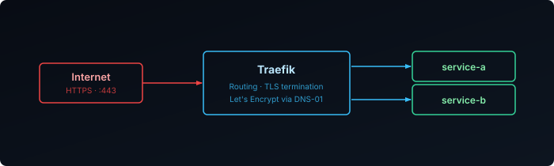
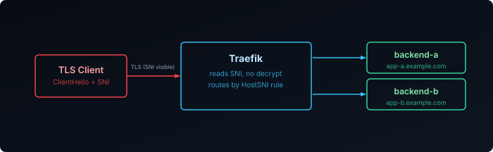

A reverse proxy sits in front of your services and decides, per connection, where it goes. Traefik's twist is that you rarely tell it about services directly: it watches Docker, reads labels off your containers, and builds its routing table on the fly. Once you understand the four building blocks it uses, every Traefik config reads the same way.



## The Four Building Blocks

Every request takes the same path through Traefik:

1. **Entry point**: a port Traefik listens on, such as `web` on `:80` or `websecure` on `:443`.
2. **Router**: a rule that matches the request (``Host(`grafana.example.com`)``, a path prefix, a TLS SNI name) and picks where it goes.
3. **Middlewares**: optional steps attached to a router that can reject, rewrite, or decorate the request before it is forwarded.
4. **Service**: the backend that actually receives the traffic, with load balancing across one or more servers.

Where that configuration comes from is the job of **providers**. The Docker provider reads container labels; the file provider reads YAML from a directory. Both feed the same routing table, and both reload live: start a container with the right labels and its route exists a second later, no restart.

That split also explains Traefik's two kinds of config. **Static config** (entry points, providers, certificate resolvers) is read once at startup and lives in command flags. **Dynamic config** (routers, middlewares, services) comes from providers and can change at any time.

## Certificates: Why DNS-01

Traefik can request Let's Encrypt certificates per router. With the **DNS-01 challenge**, it proves domain ownership by creating a temporary TXT record through your DNS provider's API instead of answering an HTTP request. The practical win: it works for services that are never exposed to the internet, which is most of a homelab. It also needs an API token, so scope it tightly. On Cloudflare that's **Zone → Read** and **DNS → Edit** on the one zone.

Until a certificate is issued, Traefik serves its self-signed `TRAEFIK DEFAULT CERT`. Seeing that in the browser means the ACME challenge hasn't succeeded yet, and `docker logs traefik` will say why.

## A Working Setup

This is the whole thing in one file: HTTP→HTTPS redirect, automatic certificates, a file provider for shared middlewares, the dashboard behind TLS and authentication, and Prometheus metrics.

```yaml {filename="traefik/docker-compose.yml"}
services:
  traefik:
    image: traefik:3.7.10
    container_name: traefik
    restart: unless-stopped
    security_opt:
      - no-new-privileges:true
    env_file:
      - .env
    command:
      - "--api.dashboard=true"
      - "--ping=true"
      - "--metrics.prometheus=true"
      - "--metrics.prometheus.addRoutersLabels=true"
      - "--providers.docker=true"
      - "--providers.docker.exposedbydefault=false"
      - "--providers.docker.network=traefik"
      - "--providers.file.directory=/etc/traefik/conf.d"
      - "--providers.file.watch=true"
      - "--entryPoints.web.address=:80"
      - "--entryPoints.web.http.redirections.entryPoint.to=websecure"
      - "--entryPoints.web.http.redirections.entryPoint.scheme=https"
      - "--entryPoints.websecure.address=:443"
      - "--entryPoints.websecure.http.tls=true"
      - "--certificatesresolvers.le.acme.dnschallenge=true"
      - "--certificatesresolvers.le.acme.dnschallenge.provider=cloudflare"
      - "--certificatesresolvers.le.acme.dnschallenge.delaybeforecheck=60s"
      - "--certificatesresolvers.le.acme.email=${ACME_EMAIL}"
      - "--certificatesresolvers.le.acme.storage=/certs/acme.json"
    labels:
      - "traefik.enable=true"
      - "traefik.http.routers.dashboard.rule=Host(`traefik.${DOMAIN}`)"
      - "traefik.http.routers.dashboard.entrypoints=websecure"
      - "traefik.http.routers.dashboard.tls.certresolver=le"
      - "traefik.http.routers.dashboard.service=api@internal"
      - "traefik.http.routers.dashboard.middlewares=lan-only@file,my-auth@file"
    networks:
      - traefik
    ports:
      - 80:80
      - 443:443
    volumes:
      - /var/run/docker.sock:/var/run/docker.sock:ro
      - ./conf.d:/etc/traefik/conf.d:ro
      - traefik_data:/certs
    healthcheck:
      test: wget --quiet --tries=1 --spider http://127.0.0.1:8080/ping || exit 1
      interval: 10s
      retries: 3

volumes:
  traefik_data:

networks:
  traefik:
    name: traefik
```

```bash {filename="traefik/.env"}
CF_DNS_API_TOKEN=<your-api-token>
DOMAIN=<your-domain>
ACME_EMAIL=<your-email>
```

A few lines worth explaining:

- `exposedbydefault=false` means a container is ignored until it opts in with `traefik.enable=true`. Without it, every container on the host gets a route.
- `delaybeforecheck=60s` gives the TXT record time to propagate before Let's Encrypt looks for it.
- The dashboard is just a router pointing at the built-in `api@internal` service, so it gets TLS and middlewares like anything else. That's why there's no `--api.insecure=true` and no port 8080 published.
- Ping and `/metrics` are served on Traefik's internal `:8080` entry point, which isn't published. See [Metrics](#metrics) for scraping it.

### Exposing a Service

Any container on the `traefik` network becomes routable with a handful of labels:

```yaml {filename="whoami/docker-compose.yml"}
services:
  whoami:
    image: traefik/whoami:v1.12.0
    labels:
      - "traefik.enable=true"
      - "traefik.http.routers.whoami.rule=Host(`whoami.${DOMAIN}`)"
      - "traefik.http.routers.whoami.entrypoints=websecure"
      - "traefik.http.routers.whoami.tls.certresolver=le"
      - "traefik.http.services.whoami.loadbalancer.server.port=80"
    networks:
      - traefik

networks:
  traefik:
    external: true
```

Read the labels against the building blocks: a **router** named `whoami` on the `websecure` **entry point**, matching a hostname, sending traffic to a **service** on the container's port 80. `loadbalancer.server.port` is the port the app listens on *inside* the container, not a published host port. Compose reads `${DOMAIN}` from a `.env` next to this file, so give it its own.

## Middlewares

Middlewares are where Traefik adds behaviour without touching the app. Each one is defined once and attached to as many routers as you like. Long definitions are easier to read in the file provider:

```yaml {filename="traefik/conf.d/middlewares.yml"}
http:
  middlewares:
    lan-only:
      ipAllowList:
        sourceRange: ["192.168.0.0/24"]
    my-auth:
      basicAuth:
        users:
          - "admin:$apr1$xyz..."   # htpasswd -nb admin <password>
    secure-headers:
      headers:
        stsSeconds: 31536000
        stsIncludeSubdomains: true
        contentTypeNosniff: true
        frameDeny: true
        referrerPolicy: "strict-origin-when-cross-origin"
```

Two rules trip almost everyone up:

- **Provider suffixes.** A middleware belongs to the provider that defined it. A Docker-labelled router using one from `conf.d/` must call it `lan-only@file`. Without the suffix Traefik reports it as missing and disables the router.
- **Order matters.** A chain runs left to right and stops at the first rejection. Put the cheapest check first:


```yaml
- "traefik.http.routers.myapp.middlewares=lan-only@file,my-auth@file,secure-headers@file"
```

If you set a BasicAuth hash in a Docker label instead, double every `$` to `$$`, or Compose swallows it as a variable.

## Beyond HTTP: TCP and UDP

HTTP routing works because Traefik can read the request. For databases, DNS, or anything else on raw TCP or UDP, Traefik drops to Layer 4 and sees much less:

- **TCP with TLS**: Traefik reads the SNI hostname from the TLS ClientHello and can route on it *without decrypting*, using `HostSNI()` and `passthrough: true`.
- **TCP without TLS**: there's nothing to inspect, so every connection on the entry point goes to one backend (``HostSNI(`*`)``).
- **UDP**: no connections and no SNI. An entry point maps straight to a service, with no rule at all.



Each non-HTTP service gets its own entry point (`--entryPoints.postgres.address=:5432`, `--entryPoints.dns.address=:53/udp`, plus the matching `ports`), then a router in `conf.d/`:

```yaml {filename="traefik/conf.d/layer4.yml"}
tcp:
  routers:
    app-passthrough:
      entryPoints: [websecure]
      rule: "HostSNI(`app.example.com`)"
      service: app
      tls:
        passthrough: true
    postgres:
      entryPoints: [postgres]
      rule: "HostSNI(`*`)"
      service: postgres
  services:
    app:
      loadBalancer:
        servers: [{ address: "192.168.1.10:443" }]
    postgres:
      loadBalancer:
        servers: [{ address: "192.168.1.20:5432" }]

udp:
  routers:
    dns:
      entryPoints: [dns]
      service: dns
  services:
    dns:
      loadBalancer:
        servers: [{ address: "192.168.1.1:53" }]
```

> TCP routers are evaluated before HTTP routers on a shared entry point. ``HostSNI(`*`)`` with passthrough on `websecure` captures every TLS connection on :443, and all your HTTPS services stop working. Only use the wildcard on a dedicated entry point.

Plain TCP passthrough also means Traefik adds no protection: the backend is exactly as exposed as if you'd opened the port on your firewall.

## Metrics

Because every request passes through Traefik, it's the one place that sees all your services' traffic. With `--metrics.prometheus=true` it counts that traffic and serves the counters in Prometheus format at `/metrics` on `:8080`.

The metrics carry the same building blocks as labels: `entrypoint`, `service`, and, with `addRoutersLabels=true`, `router`. Router labels are opt-in because each router multiplies the number of series. That's fine for a homelab and worth thinking about with hundreds of routers. The ones worth watching:

| Metric | What it tells you |
|---|---|
| `traefik_service_requests_total` | Requests per service, split by `code` and `method`: traffic and error rate |
| `traefik_service_request_duration_seconds` | Latency histogram per service |
| `traefik_tls_certs_not_after` | Expiry timestamp of each certificate |
| `traefik_config_reloads_total` | How often the routing table changed |

A few queries that turn those into answers:

```promql
# 5xx responses per second, per service
sum by (service) (rate(traefik_service_requests_total{code=~"5.."}[5m]))

# 95th percentile latency per service
histogram_quantile(0.95, sum by (le, service) (rate(traefik_service_request_duration_seconds_bucket[5m])))

# days until each certificate expires
(traefik_tls_certs_not_after - time()) / 86400
```

The last one is the most useful alert in practice. Automatic renewal fails silently, for example after an expired API token, and this catches it weeks before a browser does.

To scrape from another host, publish the port on your LAN address only (`"192.168.1.5:8080:8080"` under `ports`), so metrics and ping aren't exposed beyond it. Then add a scrape job to Prometheus:

```yaml {filename="prometheus.yml"}
scrape_configs:
  - job_name: traefik
    static_configs:
      - targets: ["192.168.1.5:8080"]
```

`up{job="traefik"}` returning `1` confirms it. The [Traefik metrics reference][metrics] lists everything else, and there's a ready-made [Traefik dashboard][dashboard] to start from.

## When Something Doesn't Route

The dashboard shows every router, service, and middleware Traefik has loaded, with the error if one failed. Most problems map to one block:

- **`404 page not found`**: no router matched. The container is missing `traefik.enable=true`, or the `Host()` rule doesn't match what you typed.
- **`Bad Gateway`**: the router matched but can't reach the service. The container isn't on the `traefik` network, or the service port is wrong.
- **Default certificate**: the resolver hasn't issued yet; check the logs for `acme` errors. Use the Let's Encrypt staging server (`--certificatesresolvers.le.acme.caserver=https://acme-staging-v02.api.letsencrypt.org/directory`) while experimenting, so retries don't hit [rate limits][rate-limits].
- **Router disabled after adding a middleware**: a missing `@file` suffix.

For everything else, the [Traefik documentation][docs] is well organized around the same building blocks.

[rate-limits]: https://letsencrypt.org/docs/rate-limits/
[docs]: https://doc.traefik.io/traefik/
[metrics]: https://doc.traefik.io/traefik/observability/metrics/overview/
[dashboard]: https://github.com/svenvg93/Grafana-Dashboard/tree/master/traefik
