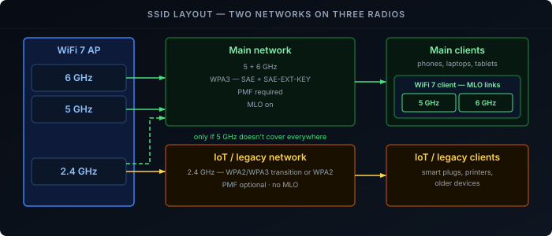
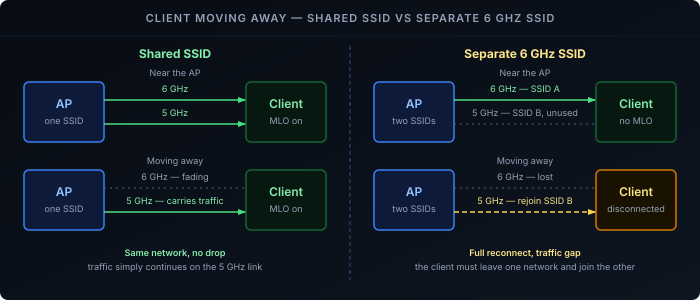

The first four parts of this series cover [transmit power, channels and width](), [roaming](), [WPA3]() and [Multi-Link Operation](). This part turns them into one configuration for a tri-band WiFi 7 network. The labels differ per vendor, the options don't.

It assumes a home network you manage yourself, with tri-band WiFi 7 APs throughout. ISP routers and guest networks can't know their clients, so their defaults rightly favour compatibility.

## Summary

| Setting | Main network | IoT / legacy network |
|---|---|---|
| Bands | 5 + 6 GHz | 2.4 GHz |
| Security | WPA3 with WiFi 7 support | WPA2/WPA3 transition, or WPA2 |
| PMF | Required | Optional |
| MLO | On | Off |
| Fast roaming (802.11r) | On, after testing | Off |
| Band steering | Off | Off |
| Channel width | 80 MHz (5 GHz), 160 MHz (6 GHz) | 20 MHz |

The rest of this post explains each row.

## Two Networks

WiFi 7 clients and a fifteen-year-old smart plug want opposite settings. One SSID can only serve both by compromising on everything, so split them:

- **Main network** — phones, laptops, tablets. WPA3 only, MLO on, 5 and 6 GHz.
- **IoT/legacy network** — smart-home devices, printers, anything that only does WPA2 or 2.4 GHz.

If every device you own supports WPA3, one SSID with the main network settings is fine. Once even one device needs WPA2, split rather than turning on transition mode for everyone — it keeps the [WPA2 weaknesses](#transition-mode) alive for every client.

Two things to avoid on the main network:

- **2.4 GHz**, unless 5 GHz doesn't reach somewhere you need it.
- **A separate 6 GHz SSID.** MLO only combines bands that share an SSID, and a client walking away from the AP would have to fully reconnect instead of quietly falling back to 5 GHz.

## Per-Band Settings

Use the [starting values](#how-power-channel-and-width-interact) from part 1 for width, channel and power. Two points matter most in the EU:

")

- **Allow DFS on 5 GHz.** Without it the EU has only one 80 MHz channel.
- **Stay at 160 MHz on 6 GHz with more than one AP.** 320 MHz only fits once in the EU, and at range it's often slower than 160 MHz.

## Security

[What WiFi 7 Adds to WPA3](#what-wifi-7-adds-to-wpa3) explains the details.

**Main network:** choose WPA3-Personal with the WiFi 7 option — vendors call it "WPA3 with WiFi 7 support", "SAE-EXT-KEY", or tie it to the MLO toggle. Set PMF to Required. Without this option, MLO stays off.

**IoT network:** WPA2/WPA3 transition, or plain WPA2 if some devices won't join. Set PMF to Optional, and use a long, random passphrase.

## Roaming

MLO spreads a client across one AP's bands, but moving between APs is still a roam. Follow the [roaming post's configuration](#practical-configuration) on the main network, with band steering off since MLO handles band selection. On the IoT network, leave all roaming features off.

## Checking It Works

After every change, check one device of each type you own — a WiFi 7 phone, an older laptop, an IoT device. Problems only show up on the clients that don't support a setting.

- **macOS** — Option-click the WiFi icon for band, width and security.
- **Windows** — `netsh wlan show interfaces`; `Radio type` shows `802.11be` for WiFi 7.
- **Linux** — `iw dev wlan0 link`; with MLO you'll see one entry per link.

| Symptom | Likely cause |
|---|---|
| Device can't join the main network | It only supports WPA2 |
| Device never uses 6 GHz | No WPA3 support on the device, or no 6 GHz radio |
| WiFi 7 device never uses MLO | WiFi 7 security option or MLO not enabled on the SSID |
| Devices drop after enabling 802.11r | Buggy fast roaming on that client — turn it off |
